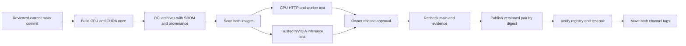

# Docker Deployment

Docker Compose runs infrastructure and the API. Linux workers also run in containers; `make up` on macOS starts native workers for Apple MLX/MPS access.

## Release status

New Docker Hub publication is disabled while the verified release path is under
review. Existing channel tags do not prove that the new qualification checks
passed. On October 12, 2026, no trusted NVIDIA test host was available. CUDA
publication remains blocked until real inference evidence exists for the exact
candidate image.

The release target is `linux/amd64`. A local ARM64 test on a Mac does not qualify
that target. Native Apple MLX workers remain a separate local runtime.

## From candidate to published image



Open Container Initiative (OCI) archives retain the image graph, software bill
of materials (SBOM), and build provenance. The publisher copies the qualified
content; it does not build it again. An archive checksum identifies transferred
bytes. A root index digest identifies the full published graph. A runnable
manifest digest identifies one platform image. A Docker image ID identifies its
configuration. These values are not interchangeable.

Candidate checks use disposable PostgreSQL, Redis and MinIO. The CPU test starts
the image's API and workers, then submits a synthetic clip over HTTP. It checks
saved annotations, a review edit, and an explicit export. Only inference is
controlled in that queue test. It does not establish model quality.

The trusted GPU check uses a pinned YOLO11 nano checkpoint and a synthetic
640 × 640 image. It checks real CUDA execution and records hardware and model
identity. It does not qualify SAM3, full training, every GPU, or camera accuracy.
A skipped GPU job blocks publication. Once hardware is available, start a new
candidate cycle so all evidence belongs to one known workflow run.

High and critical vulnerabilities block qualification, including findings with
no fix yet. A scanner error also blocks it. Do not add exclusions to get a green
result. A proposed exception needs owner approval, an expiry, and a repair issue.

### Run and inspect qualification

These steps apply after the tooling PR merges. They do not authorize a release.
Required CI, independent review, and owner approval must refer to the current
**main commit**. A merge commit does not inherit approval statuses from a PR head.

1. Open **Actions → Release — qualify immutable candidates → Run workflow**.
   Select `main`. Leave CUDA qualification off until a trusted NVIDIA runner is
   provisioned. The workflow checks the source again before it builds. Start a
   new workflow run after a failure; rerun attempts cannot qualify a candidate.
2. Inspect each candidate job. A successful job retains its OCI archive, manifest,
   scan and runtime evidence for two days. Download the evidence before it expires.
   Record the workflow run ID. A failed scan or smoke test cannot qualify an image.
3. When hardware is available, use a trusted runner with labels `self-hosted`,
   `linux`, `x64`, and `waldo-cuda`. Set `WALDO_CUDA_RUNNER_ENABLED=true` only after
   review of that host. Run a new candidate cycle with CUDA qualification on.
   The publisher rejects skipped GPU work, stale source, expired artifacts,
   changed bytes, and a mismatched pair.
4. The publisher's `dry_run` input defaults to true. It verifies the candidate
   run and downloaded artifacts without a Docker Hub login or write. Supply the
   candidate run ID and a version such as `v1.2.3`. Without real GPU evidence,
   this validation must fail.

Large builds and artifact copies need free disk space. The scripts check estimated
capacity before work starts. These estimates are not measured image sizes. A
larger approved runner can be required. Do not prune a shared host to force a run.

### Before enabling publication

The remote publisher workflow is disabled, and its publication job also has a
literal false condition. Enabling publication requires a separate reviewed change
and owner release approval after all qualification gates pass.

In the protected `release` environment, provision `RELEASE_DOCKERHUB_USERNAME`
and `RELEASE_DOCKERHUB_TOKEN`. Remove the old repository-level `DOCKERHUB_USERNAME`
and `DOCKERHUB_TOKEN` copies. Do not create repository-level copies of the new
names. These distinct names avoid fallback to legacy credentials, but GitHub's
secret lookup cannot prove where a secret was stored. The owner must verify the
settings. No secret is needed for local smoke or PR checks.

The single publisher checks current main and approvals again after the protected
environment opens. It validates both images and trusted GPU evidence before login.
It rejects a version tag that already points to different content. It publishes
both version tags, verifies their digests and runtime behavior, then moves `latest`
and `cuda`. It does not deploy the user's running stack.

### Recover a partial publication

Registry tag updates are not atomic. Before the first write, the publisher saves
a `release-intent` artifact. This preserves the intended and previous pairs if
the runner stops before it can upload its final record. The `release-record` contains the
intended pair, previous channel digests, evidence identities, confirmed writes,
uncertain writes, and a `complete` flag. It is retained for 90 days; keep an approved
copy outside Actions for longer-term recovery. Download the record after a failed
publication before making any further tag changes. If the final record is absent,
use the saved intent and inspect current registry digests; a write may have happened
before the runner stopped.

If `complete` is false, stop deployment. An owner-approved retry can supply
`resume_publish_run_id` with the prior publisher run ID. Recovery selects the
final record when present, or the saved intent otherwise. It must use the same
candidate run, version, source, and immutable pair. The source and evidence must
still pass all gates. A moved main branch or expired candidate can block a retry.
Do not substitute a new image under an existing version.

To restore channel tags instead, use the recorded **previous pair**. Copy each
previous root digest to its channel with the pinned tool and verify readback:

```sh
regctl image copy oldhero5/waldo@sha256:PREVIOUS_CPU_DIGEST oldhero5/waldo:latest --force-recursive
regctl image copy oldhero5/waldo@sha256:PREVIOUS_CUDA_DIGEST oldhero5/waldo:cuda --force-recursive
regctl image digest oldhero5/waldo:latest
regctl image digest oldhero5/waldo:cuda
```

These are registry writes and require owner approval. Both returned digests must
match the previous record. Keep the failed version tags and recovery evidence;
do not overwrite versioned content. A first release may have no previous pair.
In that case there is no prior channel pair to restore; keep deployment stopped
until the owner approves completion or another recovery action.

## Image tags

Compose references Docker Hub images at [`oldhero5/waldo`](https://hub.docker.com/r/oldhero5/waldo). Each image supports three roles (app, labeler, trainer), selected via `WALDO_ROLE`.

| Tag | Base | When to use |
| --- | --- | --- |
| `oldhero5/waldo:latest` | `python:3.11-slim` | App container and Linux/CPU workers |
| `oldhero5/waldo:cuda` | `nvidia/cuda:13.0.3-runtime-ubuntu24.04`; torch/torchvision installed from `cu130` wheel index | NVIDIA GPU labeler / trainer |

The CUDA runtime and explicit torch wheel source both use the CUDA 13.0 family; torch/torchvision versions are pinned. The image and host driver still need qualification on the target GPU before release. The base tag is listed in [NVIDIA supported tags](https://gitlab.com/nvidia/container-images/cuda/-/blob/master/doc/supported-tags.md).

The compose file picks the right tag per service:

- `waldo-app` → `:latest` (no GPU needed for the API tier)
- `waldo-labeler`, `waldo-trainer` (`apple` + `cpu` profiles) → `:latest`
- `waldo-labeler-nvidia`, `waldo-trainer-nvidia` (`nvidia` profile) → `:cuda`

Override either tag with `WALDO_TAG`/`WALDO_CUDA_TAG` to select a version (for example,
`WALDO_TAG=1.2.3` and `WALDO_CUDA_TAG=1.2.3-cuda` for a completed release).

These variables select tags. For a verified deployment or rollback, use the full
digests from the completed release manifest as described below.

## Quickest start: `make up`

`make up` auto-detects your host OS **and** GPU at make-time, pulls the published image(s), and brings the stack up. The detection lives at the top of the Makefile:

- **macOS (Darwin)** → `apple` profile, runs `make up-mac`: infra + app pulled from Docker Hub, labeler and trainer workers **natively on the host** so they can reach Apple's MPS/MLX (MLX cannot run inside a Linux container). Labeler logs land in `/tmp/waldo-labeler.log`, trainer logs in `/tmp/waldo-trainer.log`.
- **Linux / WSL2 with `nvidia-smi` on `$PATH`** → `nvidia` profile, runs `make up-linux`: pulls `:cuda` and starts the GPU workers.
- **Linux / WSL2 without an NVIDIA GPU** → `cpu` profile, runs `make up-linux` against the CPU image.

On Linux, override detection with `make up PROFILE=nvidia` (or `cpu`). On macOS, `make up` selects `up-mac` regardless of profile. These startup paths pull images; see the build override below for local image builds.

Labeling dispatch selects native MLX only when the host/device supports it; project shape no longer selects the backend. Darwin dependency markers exclude `mlx` and `mlx-vlm` from Linux installs.

## docker-compose.yml

The Compose file brings up infrastructure and the selected worker profile. Add
`--profile local-chat` to include Ollama. `make up` retains local chat by default;
`make up CHAT_PROFILE=` omits it. `AGENT_MODEL` is the canonical model setting; the
old `WALDO_AGENT_MODEL` value is no longer used by the model download container.
The API does not wait for Ollama, and liveness does not imply model readiness.

For an external Ollama server inside Compose, set `OLLAMA_COMPOSE_URL`. Service
credentials use the same `POSTGRES_*` and `MINIO_*` variables as the application.
Changing these values does not rotate credentials in an existing database volume.

Basic commands:

```bash
docker compose --profile cpu pull          # or: --profile nvidia / --profile apple
docker compose --profile cpu up -d
docker compose ps                          # check service health
docker compose logs -f waldo-app           # tail backend logs
docker compose down                        # stop everything (data persists)
docker compose down -v                     # nuclear: also delete volumes
```

To build the images locally instead of pulling — for contributing, or running an unmerged branch — layer the build override:

```bash
docker compose -f docker-compose.yml -f docker-compose.build.yml \
    --profile nvidia up -d --build
# or:
make build PROFILE=nvidia
```

The override builds `Dockerfile` (CPU) and/or `Dockerfile.cuda` (GPU) locally and tags them `oldhero5/waldo:dev` / `:dev-cuda` so they don't shadow the published images.

## Services

| Service | Port | Image | Health endpoint |
| --- | --- | --- | --- |
| `waldo-app` | 8000 | `oldhero5/waldo:latest` | `/health` |
| `waldo-labeler` (`apple` + `cpu`) | — | `oldhero5/waldo:latest` | Celery `ping` |
| `waldo-trainer` (`apple` + `cpu`) | — | `oldhero5/waldo:latest` | Celery `ping` |
| `waldo-labeler-nvidia` (`nvidia`) | — | `oldhero5/waldo:cuda` | Celery `ping` |
| `waldo-trainer-nvidia` (`nvidia`) | — | `oldhero5/waldo:cuda` | Celery `ping` |
| `postgres` | 5432 | `postgres:16-alpine` | internal |
| `redis` | 6379 | `redis:7-alpine` | internal |
| `minio` | 9000 (S3) / 9001 (console) | `minio/minio` | `/minio/health/live` |
| `ollama` (`local-chat`) | 11434 | `ollama/ollama` | `ollama list` |

Postgres, Redis, Ollama and MinIO are bound to `127.0.0.1` by default — the dev-default `minioadmin/minioadmin` credentials should never be reachable from the LAN. Open the [console](http://127.0.0.1:9001) or [S3 API](http://127.0.0.1:9000) locally. Set `MINIO_BIND=0.0.0.0` in `.env` if you need to reach it from another machine on your LAN.

## Profiles

The compose file uses Docker Compose profiles to route services to the right hardware. `make up` auto-detects the right one; you can also pick one explicitly:

```bash
docker compose --profile nvidia up -d   # Linux/WSL + NVIDIA GPU (pulls :cuda)
docker compose --profile cpu    up -d   # Linux/WSL without a GPU (pulls :latest)
make up                               # macOS: containers + native workers
```

The `apple` and `cpu` Compose profiles activate the same Linux worker containers. Selecting `apple` directly does not enable MLX/MPS; use `make up` on macOS for native workers.

## Volumes

| Volume | Purpose |
| --- | --- |
| `pgdata` | Database |
| `miniodata` | Object store |
| `model_cache` | HuggingFace model cache shared across workers |
| `ollama_data` | Sidecar LLM weights for the in-app agent |

Back the database up with:

```bash
docker compose exec -T postgres pg_dump -U waldo -d waldo -Fc > waldo-db.dump
```

## Updating

```bash
git pull
docker compose --profile <cpu|nvidia|apple> pull
docker compose --profile <cpu|nvidia|apple> up -d
```

Migrations run automatically on `waldo-app` startup via Alembic. Before upgrading existing data, read [legacy ownership recovery](../architecture/security#upgrading-legacy-ownership). There is no separate `--build` step — the image is published.

## Deploy or restore a verified pair

Use only a manifest marked complete after both image checks and both channel
updates. Keep the previous completed manifest and a checked database backup.
An incomplete record is a recovery record, not permission to deploy.

Compose's tag variables cannot hold `repository@sha256:digest` references. Create
an override file named `waldo-images.yml` outside the repository. Replace both
placeholders below with the full digests from the approved manifest:

```yaml
services:
  waldo-app:
    image: oldhero5/waldo@sha256:CPU_DIGEST
  waldo-labeler:
    image: oldhero5/waldo@sha256:CPU_DIGEST
  waldo-trainer:
    image: oldhero5/waldo@sha256:CPU_DIGEST
  waldo-labeler-nvidia:
    image: oldhero5/waldo@sha256:CUDA_DIGEST
  waldo-trainer-nvidia:
    image: oldhero5/waldo@sha256:CUDA_DIGEST
```

For a qualified Linux CPU host, run:

```sh
docker compose -f docker-compose.yml -f /path/to/waldo-images.yml --profile cpu pull
docker compose -f docker-compose.yml -f /path/to/waldo-images.yml --profile cpu up -d
```

Use `--profile nvidia` only on a qualified NVIDIA host. The application still uses
the CPU image; NVIDIA workers use the CUDA image. Check API health and the bounded
label, review and export flow after startup. Do not assume container startup
means inference is ready.

To roll back containers, use the saved override with **both previous digests**
and repeat `pull` and `up -d`. These commands retain named volumes. Do not use
`down -v` or remove database or object-store volumes during recovery. A container
rollback does not reverse a database migration. Check compatibility with the
current schema; a forward repair can be required.

## Image internals

Both `Dockerfile` and `Dockerfile.cuda` use a multi-stage layout:

1. **`ui-builder`** (node:20-alpine) — `npm ci` + `npm run build`, dropping the SPA into `/app/static`.
2. **`runtime`** (slim or nvidia/cuda) — installs ffmpeg and Python dependencies, copies source trees and the built UI, and installs the project into the venv. The CPU image uses frozen `uv sync`; the CUDA image separately installs torch/torchvision from the `cu130` index and finishes with `uv pip install --no-deps -e .`.

The `WALDO_ROLE` environment variable picks which process runs at startup:

```sh
WALDO_ROLE=app       # uv run alembic upgrade head && uvicorn app.main:app
WALDO_ROLE=labeler   # celery -A lib.tasks worker -Q celery
WALDO_ROLE=trainer   # celery -A lib.tasks worker -Q training
```

For CUDA builds, the worker entrypoint additionally prints `nvidia-smi` and `torch.cuda.is_available()` at boot, so `docker compose logs waldo-labeler-nvidia` immediately tells you whether passthrough is wired up.
