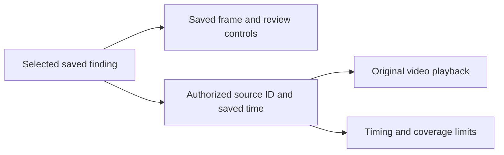

# Inspect saved detections in source video

> Implement with the subagent-driven-development and test-driven-development
> workflows. Follow AGENTS.md and CONTRIBUTING.md.

## Goal and design

Open a saved finding in Review and watch its original video at the recorded
time. Keep the saved frame and review controls beside playback. Filter findings
by source clip and class as well as the existing status and confidence filters.

The owner approved this feature after PR #22. It comes before Docker Hub release
qualification. Root and Sol buddies `next_product_slice` and `source_design`
chose the existing Review page and saved annotation records. This avoids a new
search workspace or an assessment migration for a positive-finding workflow.
Durable empty-frame assessments remain a separate feature.



Use FastAPI, SQLAlchemy, React, the current authorization helpers and signed
download proxy. Do not change dependencies, model defaults or database schema.
This document is the feature specification and implementation plan.

## Data and scope

- A saved annotation belongs to one job and frame. The frame identifies its
  source video. Local track IDs do not identify a video or a physical asset.
- Times are floating-point seconds relative to the source container start.
  `source_pts` records source presentation timing. `frame_index/fps` and
  `resampled_ordinal/fps` are approximate. Unknown provenance, missing, negative
  or nonfinite times must not produce an automatic seek.
- `lib/video_timing.py` subtracts container start time when it records source
  times. The browser can expose a nonzero native timeline. At the first decoded
  load of a fresh paused source, before any app seek, capture native current time.
  Use it as the browser origin only if it lies in a single seekable range and
  the span from it to the range end matches saved duration within 0.1 seconds.
  Freeze the origin for that URL and verify the completed seek reaches its
  target. An unknown duration, ambiguous range or clamped seek leaves navigation
  manual with a visible message. Do not infer origin from buffered ranges or
  the first video-frame timestamp. Test nonzero starts and audio before video.
- A decoded duration can reject an out-of-range seek. Do not silently clamp a
  bad timestamp or treat it as zero. A valid zero timestamp remains valid.
- Some Video rows represent standalone images and have no playable source.
  Keep their frame review available. A stored source key does not prove that a
  browser supports its codec or that the object still exists.
- Keep sampled and unknown coverage visible. Do not infer absent objects from
  missing detections, draw sparse masks across moving video, or infer locations.
- Private local videos are development material, not a holdout. Do not change
  seeds, prompts, thresholds, model artifacts or metrics. Keep footage, crops,
  names and detailed local reports out of Git, Docker contexts and CI artifacts.

## Acceptance and review focus

1. A saved finding opens its correct source at the saved time after reload and
   API restart, without inference. Two clips with the same time and track ID
   stay separate. Another finding in the same clip can seek to its own time.
2. Source and class filters combine with status/confidence filters. Counts and
   bulk review actions act on the displayed scope. Empty results are explicit.
3. Exact, approximate, unknown, invalid and out-of-duration times have clear
   behavior. Source playback must not claim frame-perfect mask alignment.
4. Both new routes authorize the job and source. An unrelated clip in the same
   workspace, a foreign workspace and an unauthenticated caller cannot obtain
   a source capability. Merged or copied jobs resolve their saved sources.
5. Source URL renewal is bounded. A persistent failure offers manual retry.
   Late requests from an old source or identity cannot replace current media.
   Same-source renewal retains playback position and paused state. Video errors
   do not clear saved review state or unsaved annotation points.
6. Native playback controls and filters work with keyboard input and a narrow
   viewport. The source panel must not cover frame controls or consume the
   player's keyboard shortcuts in the annotation handler.

## Task 1: saved-source inspection

**Files:** `app/api/review.py`, new `tests/test_review_sources.py`, `ui/src/api.ts`,
`ui/src/pages/ReviewPage.tsx`, `ui/src/components/AnnotationCanvas.tsx`, new
`ui/src/components/SourceVideoPlayer.tsx`, new
`ui/e2e/source-video-inspection.spec.ts`, and `ui/playwright.smoke.config.ts`.
Add a small timing helper only if needed to keep consistent labels and behavior.
Root owns documentation and integration evidence; the implementer owns these
code and test files. Coordinate any additional file before editing it.

**API contract:**

```text
GET /api/v1/jobs/{job_id}/sources
  [{id: string, filename: string, duration_s: number | null,
    has_source_video: boolean}]
GET /api/v1/jobs/{job_id}/sources/{video_id}/playback
  {video_id: string, url: string}
```

The list contains distinct authorized sources joined through this job's saved
annotations and frames, in stable order. It does not sign every source URL.
The playback route rechecks the same relationship, then uses `get_download_url`.
An inaccessible or unrelated source returns 404. Unavailable standalone-image
sources return no capability. No source selection may enumerate all projects.

**UI contract:** preserve the current full-screen frame inspector. Give it an
optional adjacent source panel and an initial annotation selection. A per-row
Inspect action selects that annotation; clicking a frame selects its first
visible annotation. Source media updates must not remount the frame editor.
Use a native video element, clear source/timing labels, and the existing neutral
styles. The source metadata list gives filter labels; annotation source IDs
remain authoritative. A failed metadata request must not remove saved evidence.

- [x] Add API tests that fail because source routes are missing. Use isolated
  resource fixtures; cover membership, ordering/deduplication, still images,
  copied sources, fresh capability signing and unauthorized access.
- [x] Run `pytest tests/test_review_sources.py -q`; record the intended failure.
  Add the minimum routes and rerun with review timing/download regressions.
- [x] Add browser tests for the acceptance cases before UI implementation.
  Include real decoded synthetic media and an observable seek result, not only
  assignments to `currentTime`. Generate only small synthetic fixtures.
- [x] Build and run the focused browser suite to record missing-feature
  failures. Add the UI, source client calls and bounded renewal behavior.
- [ ] Run the focused tests, then the required browser suite, UI build/lint,
  backend regressions, Python lint/format and `git diff --check`. Inspect every
  failure and skip. Preserve existing test assertions.
- [x] Self-review and commit coherent code/test changes through the orchestrator.
  Give the independent reviewer the exact diff, acceptance checks and test logs.

## Task 2: local qualification and review

Root runs this qualification, with a fresh Sol reviewer who did not design or
author the implementation. Test only on disposable services or a separate test
workspace. Never run destructive fixtures against the user's application data.

- [x] Run a bounded workflow using private local footage. Upload the source to
  local storage, inspect saved detections through the real API and browser, seek,
  change clips, review a finding, reload and restart the API. Reopen the same
  saved evidence. Do not send footage to a cloud service.
- [x] Use synthetic exact-time, approximate-time and nonzero-start fixtures to
  establish timing behavior. A local video smoke proves usability and transport,
  not physical-camera recall or world location accuracy.
- [x] Record code version, runtime, test counts, local evidence and limits.
  Public documentation contains only aggregate results and synthetic examples.
- [x] Update the roadmap to put this product feature before release machinery.
  Include a short human test plan and rollback instructions in the feature PR.
- [ ] Run hosted CI on the final commit. Obtain a fresh independent review of
  that commit, fix findings and re-review material changes. Bring the PR to the
  owner with Human approval still pending. Do not merge this feature yet.

## Local qualification

The feature PR records the final commit, full browser result, hosted CI and
independent review. Its approval remains separate from this implementation plan.

The full Linux backend run passed 745 tests and skipped 10. All required queued
worker cases ran. Eight skips require Apple hardware; two require opt-in live
workflows. The run used disposable PostgreSQL, Redis and MinIO services with
frozen dependencies. It did not use the owner's running database.

A separate native smoke on an Apple M2 Max used two private 4K HEVC clips and
cached offline SAM 3.1 MLX revision
`a992e302ea9b0f03f41dfd93414a4fd0e818f65b`. At one sample per second and confidence
0.35, the existing worker assessed 11 frames and saved 210 observations in
36.82 seconds. Both original videos decoded in Google Chrome. Source/class
filters, a one-second seek, and review of the selected finding passed. The same
saved observations and accepted state survived page reload and an API restart
without another inference run. These are transport and workflow checks, not
measured detection accuracy. Private media and detailed reports remain local.

## Human test and rollback

The nonzero-start fixtures disproved the original assumption that a browser seek
could always use saved seconds directly. A malformed fixture also exposed a
misleading seekable range in some browser loads. Other loads navigated that same
fixture correctly, with the expected decoded pixels. Its test therefore requires
correct decoded navigation or an explicit manual-playback warning.
Sol `source_design`, the implementer and root chose
the guarded initial-position mapping above. It uses the browser timeline
without changing saved source times. Unsupported or inconsistent metadata leaves
navigation manual rather than guessing a frame.
The [HTML media standard](https://html.spec.whatwg.org/multipage/media.html)
permits a nonzero native timeline. The browser fixtures, rather than a model
name or a timestamp label, establish which navigation cases this feature checks.

Open a completed video job in Review. Filter by clip and class. Inspect one
finding, check the saved frame beside source playback, and seek to another
finding. Accept or reject a label and reload. The change must persist. An image
only source or failed video must leave frame review usable.

Rollback is an application-code revert. This feature makes no schema changes
and does not change saved annotations or source objects during playback.
