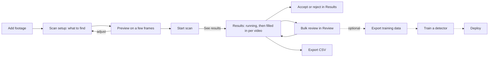

# Waldo interface redesign

> Design document. Each wave below gets its own implementation plan, written
> with `superpowers:writing-plans`, before code starts. Implement with the
> subagent-driven-development and test-driven-development workflows. Follow
> AGENTS.md and CONTRIBUTING.md.

## Problem

Waldo can label objects in video, show each finding in its source video, train
a detector and serve it. The interface makes this hard for a person who is not
a machine learning (ML) engineer:

- **Uploaded videos have no home.** After upload, the only link to a video is a
  button shown once (`ui/src/pages/UploadPage.tsx:96-103`). `/collections` and
  `/jobs` are not in the navigation (`ui/src/components/Sidebar.tsx:23-31`).
- **The nouns disagree with the data.** "Collection" is an API project.
  "Dataset" is a labeling job. "Experiment" means a training run on one page and
  a traffic test on another. Activate, Promote and Champion name overlapping
  actions on different pages.
- **Background work disappears.** Only training and comparison show global
  progress. Labeling, auto-labeling on upload, exports and video predictions
  have no indicator. Label page progress is lost on navigation
  (`ui/src/pages/LabelPage.tsx:90`).
- **Failures are silent.** Review accept, reject and bulk actions log only to
  the console (`ui/src/pages/ReviewPage.tsx:295-303,352-376`). The app has no
  app-level toast or live region, and it uses 21 native `confirm`, `alert` and
  `prompt` calls.
- **Two defects change results.** The full labeling run ignores the minimum
  score the user tested, so the 0.5 default applies
  (`ui/src/pages/LabelPage.tsx:150-155`, `app/api/label.py:48`). Enter in the
  prompt box starts a full GPU job (`ui/src/pages/LabelPage.tsx:288-290`).
- **The result is a label queue, not an answer.** After a run, the user lands in
  a review grid. Nothing shows where objects appear in time, what Waldo
  examined, and what it did not examine.
- **The visual system is inconsistent.** Many font sizes, 4 class-colour
  algorithms, about 8 status-colour maps, a near-white accent that looks like
  body text, low-contrast white-on-colour buttons, a fixed 224 px sidebar with
  no small-screen layout, and global `!important` overrides
  (`ui/src/index.css:257-296`).

The research behind these findings is summarized in [Evidence](#evidence).

## Owner decisions (October 31, 2026)

The owner chose these from options in the project chat:

| Question | Decision |
| --- | --- |
| Direction | **Hybrid.** Ship shared foundations and a footage library first. Then add a results view with a coverage timeline, and upgrade Review. |
| Primary user | **Evidence analyst.** A person who is not an ML engineer. They have drive or site footage and want to find where objects appear and verify each finding. The roadmap describes this workflow (`docs-site/docs/architecture/roadmap.md:8-10,107-110`). |
| Counting | **Findings and coverage only.** Show where objects appear, what Waldo examined and what it did not. No headline count of objects. |
| Delivery | **One PR per wave.** Each wave gets its own independent review and owner approval. |
| Terms | **The proposed set** in [Terms](#terms). |
| Results list | **Group consecutive findings into time spans.** Spans expand to their findings. Spans are never totalled or called objects. |
| Default minimum score | **0.35, as previewed.** A Label-page scan sends the value the slider shows. Untouched scans change from 0.5 to 0.35 and give more findings than today. The wave 1 PR and the docs state this change. |
| Formatting | **A format-only Prettier PR first** (wave 0). |

The ML engineer remains a supported secondary user. No expert control is
removed. Expert controls move one level down, behind clear labels.

## Intent

A person with footage and a question opens Waldo, adds the footage, asks for an
object in plain words, and gets results they can trust and verify: where the
object appears, which moments Waldo examined, which it did not, and the source
video at each finding. Training a detector is an optional next step, not the
price of an answer.

### Experience principles

These guide decisions that this document does not cover.

1. **One obvious next step.** Every screen ends with one primary action that
   follows from real state.
2. **Nothing gets lost.** Long work continues in the background. The user can
   leave any page and find the work again in one place.
3. **Fast and reversible.** Review actions update at once and offer Undo. A
   failed save rolls back and says so.
4. **Honest.** Never claim more than Waldo examined. Unknown stays unknown.
5. **Plain words first.** ML terms appear only where the user chooses ML work,
   and each has a one-line explanation.
6. **Keyboard for repeated work.** Repeated actions have shortcuts that a
   help sheet lists. First-time use works with a mouse alone.

## Goals

1. Every uploaded video is reachable from the navigation and shows its scan
   state and one next action.
2. One activity tray shows all background work with honest states, from any
   page.
3. A results view shows, for one scan, coverage per object, findings over time,
   time spans with their findings, source playback, accept and reject for the
   selected finding, and a CSV export.
4. One design system: tokens, primitives, consistent states, keyboard support,
   visible focus, at least 4.5:1 text contrast and a small-screen layout.
5. The known defects are fixed, each with a regression test that fails first.
6. Review becomes fast and safe for daily use: optimistic actions with Undo,
   class reassignment, a shortcut help sheet and filters kept in the URL.
7. Docs and the quickstart match the interface at the end of each wave.

## Non-goals

- The roadmap Search workspace with a map, location claims and indexed
  retrieval (roadmap steps 3, 6, 7 and 8). Those depend on backend work that
  does not exist. This redesign leaves room for them but does not fake them.
- Headline object counts, "most at once" figures, area filters or line-crossing
  counts.
- Merging Playground into the Label page. Fix the defects and link the two pages
  instead.
- A new frontend framework, component library or state library. Keep React 19,
  Tailwind 4, TanStack Query and react-router 7.
- Changes to labeling, training or inference behavior, with two exceptions the
  owner approved or must approve: a Label-page scan sends the minimum score the
  user saw (wave 1), and "Make live" uses promote, which also moves the champion
  alias (wave 9, owner approval required). Two known backend defects are
  reported separately (see [Separate reports](#separate-reports)).
- Edge deployment UI, the desktop app and the System 1 work (on hold).
- Removing the floating read-only assistant panel. It is a documented decision
  (`docs-site/docs/ui/agent.md:44-45`).
- Deleting dead code that was unused before this redesign (`Nav.tsx`,
  `AnnotationOverlay.tsx`, the `zustand` dependency). AGENTS.md section 3 says
  to report it separately.

## Anti-goals

The redesign fails, even if it works, if it does any of these:

- Shows progress the backend does not report, such as "120 of 600 frames" or
  "Labeling 40%" for one video.
- Shows "nothing found" for moments that Waldo did not examine, or for an
  object it did not search for, or counts a failed video as zero.
- Shows a number that a reader can take as a count of physical objects.
- Weakens a test to get a green result, or changes a pinned string or selector
  without listing it as a contract edit.
- Puts ML jargon (SAM, YOLO, epochs, mAP, output format) in the first-use path.
- Ships as one large PR, or bundles unrelated changes into a wave.
- Uses private footage in a PR, screenshot or public document.

## Users

**Evidence analyst (primary).** They have 1 to 50 videos from a moving or fixed
camera, for example drive footage. They want to know where an object appears
and how sure Waldo is. They verify findings in the original video and leave with
a list of time spans they can hand to someone. They do not know what
segmentation, a threshold or a training run is.

**ML engineer (secondary).** They label, review, export, train, compare and
serve detectors. They need every current control, fast review and keyboard
shortcuts. They accept one extra click to reach expert controls.

## Terms

The owner approved these user-facing terms. "Local track" was added after the
independent review, to follow the AGENTS.md rule that a local track ID is not a
physical object; the owner can change it. API and code names do not change.

| Concept | API or code name | UI term | Replaces |
| --- | --- | --- | --- |
| Group of videos | Project | Collection | Collection |
| The media area | — | Footage | Upload, Collections |
| One labeling run over one video or a collection | LabelingJob | Scan | Dataset, Job, Labeling job |
| One detection in one frame | Annotation | Finding | Label, annotation, detection |
| Consecutive detections that a tracker linked in one video | `track_id` (only on some workers) | Local track | Tracked object |
| Consecutive findings of one object class in one video | — (computed in the browser) | Time span | — |
| Frames the scan looked at | `assessed_timestamps_s` | Examined / not examined | Checked, sampled |
| An object class the scan did not look for in a video | — | Not searched | — |
| Review state of a finding | `pending`, `accepted`, `rejected` | Not reviewed, Accepted, Rejected | Pending |
| Lowest model score kept | `threshold`, `score_threshold` | Minimum score | Threshold, sensitivity, Min conf |
| A scan's reviewed findings as training data | Export of a LabelingJob | Training data | Dataset |
| Training runs area (navigation) | — | Training | Experiments |
| One training run | TrainingRun | Training run | Experiment |
| A champion and challenger traffic test | Experiment (serve) | Traffic split, with Live model and Candidate | Experiment, blue-green, champion, challenger |
| Make a model the served model | `promote(champion)` | Make live | Activate, Promote, Champion |

Rules:

- "Examined" describes Waldo's coverage only. "Reviewed" describes a person's
  decision only. Never use "checked" for either.
- "Search" stays reserved for the roadmap's indexed retrieval.
- A scan's display name is `job.name` when set, otherwise
  "<object words> — <collection or file name>", built in the browser. The user
  can rename it through the existing `PATCH /jobs/{job_id}`.
- Model scores appear as "score 0.87" on new screens and as `score_0_to_1` in
  the CSV. New screens, the CSV export panel and the docs give the hint "model
  score, not a probability". Review keeps its current percentage
  until a wave lists that change as a contract edit.

## Information architecture

### Navigation

The sidebar has three groups and a footer:

- **Main:** Home, Footage, Scans.
- **Train and deploy:** Training, Deploy.
- **Tools:** Playground (new), Workflows (beta), Assistant.
- **Footer:** Settings, and an account menu. The workspace name stays visible as
  plain text outside the menu. The menu holds Sign out.

At 1024 px and wider the sidebar is a full rail. Below 1024 px it is a drawer
opened from a top bar. In drawer mode, the assistant launcher moves into the top
bar so it never covers bottom actions.

Detail pages (Label, Results, Review, Train) highlight their parent item and
show a breadcrumb, for example "Scans / truck — Site A / Review".

### Routes

| Route | Screen | Replaces or changes | Wave |
| --- | --- | --- | --- |
| `/` | Home | Dashboard | 3 (copy), 6 (content) |
| `/footage` | Footage library, all videos grouped by collection, `?collection=` filter | `/upload`, `/collections` | 4 |
| `/label/:videoId`, `/label/collection/:projectId` | Scan setup | Same routes, new copy and layout | 5 ("See results" link), 8 (layout) |
| `/results/:jobId` | Results view (new) | — | 5 |
| `/review/:jobId` | Review studio | Same route | 7 |
| `/scans` | Scan list (today's Datasets page, moved, with new copy) | `/datasets`, `/jobs` | 8 |
| `/training`, `/train/:id` | Training runs and run detail | `/experiments`; `/train/:id` keeps its semantics | 9 |
| `/deploy/:tab` | Deploy | Same routes; default tab becomes Test | 9 |
| `/settings/:tab` | Settings | `/settings`; the tab moves into the URL | 10 |
| `/playground`, `/workflows/*`, `/agent` | Tools | Same routes | — |
| `*` | Not found page (new) | Today unknown paths render nothing | 2 |

Rules:

- A redirect lands only in the PR that builds its target. `/jobs` therefore
  redirects in wave 8, not wave 4.
- `/train/:id` keeps accepting a job ID or a run ID, because three smoke routes
  use it (`/train/chart-run`, `/train/training-run`, `/train/coverage-job`).
- In wave 3 the nav labels and page headings change (copy only). Until later
  waves move the routes, "Footage" points at `/upload` (wave 4), "Scans" at
  `/datasets` (wave 8) and "Training" at `/experiments` (wave 9).

### Primary flow

## Screens

### Home

- One next-step card computed from real state, in this order:
  1. A scan is running → "See progress" (opens Results).
  2. A finished scan has findings not reviewed → "See results for <scan>".
  3. Footage was never scanned → "Scan <collection or video>".
  4. No footage → "Add footage".
- A second, smaller item shows an active training run when one exists.
- Recent collections and recent scans, newest first.
- The stat strip with its "Annotations" total is removed.
- Loading shows skeletons, not zeros. The new-user card appears only after data
  loads and is empty.
- The page has no `<canvas>` (pinned).
- Data: the scan list with the additive `project_id` and `created_at` fields,
  and a pending-finding count (an additive field or the existing stats
  endpoint; the wave 6 plan picks one and avoids one request per scan).

### Footage library

- `/footage` lists all videos under collection headings. Most users have one or
  two collections, so a flat page saves a click. `?collection=` filters to one.
- Each video row shows file name, duration when known, upload date and one scan
  chip. A scan "has an entry for" a video when it is a single-video scan for
  that video, or its per-video coverage or one of its merged runs lists the
  video. A child run that has merged (`processing_summary.merged_into`) counts
  as part of its master scan, not as a separate scan. The chip is set this way:
  1. "Scanning · truck" while a scan for this video, or a collection-scope scan
     for its collection, runs.
  2. Otherwise, take the newest finished scan that has an entry for the video
     or is a collection-scope scan of its collection. Then:
     - no entry for the video: "Not examined in last scan", for example because
       the video was added after that scan and nothing has merged for it;
     - the video's entry failed: "Failed in last scan";
     - the video's entry finished: "Scanned · truck", or "2 scans" when more
       than one finished scan has an entry for it. The chip names only the
       object words searched in this video, so it never reads as "fully
       examined".
  3. "Not scanned" when no such scan exists.
- Row actions: "Scan" (primary when not scanned), "Results" (newest scan),
  "Try in Playground".
- Standalone images show as one "Images (n)" row, not as a video named
  `__standalone_images__`.
- Videos without saved frames show a neutral placeholder with the file name.
  This redesign adds no thumbnail backend.
- The backend cannot delete, rename or move videos or collections. The library
  shows no such controls and says so in its help text.
- **Add footage drawer.**
  - Keyboard-accessible drop zone and file picker.
  - The collection field suggests existing names. Typing an existing name says
    "Adds to the existing collection".
  - Before upload, if the collection has a finished scan, the drawer warns:
    "Videos added to Site A are scanned for 'truck' automatically and added to
    the scan 'truck — Site A'" (`app/api/upload.py:68-113`). Behavior does not
    change.
  - Per-file byte progress with Cancel, using `XMLHttpRequest` upload progress.
    After 100%: "Saving on server". The browser rejects files over the server
    limit of 10 GiB (10 × 1024³ bytes, `app/api/upload.py:190`) before upload.
  - Upload state lives at the app-shell level, so the wave 6 activity tray can
    show running uploads. Leaving the page while an upload runs asks for
    confirmation (`beforeunload`).
  - If the server reused an existing video, the drawer names the existing file
    and its upload date, and says to rename the file to keep both
    (`app/api/upload.py:216-233`).
  - When uploads finish, one primary action: "Scan these N videos" or "Scan
    collection".

### Scan setup (Label page)

- First field: "What do you want to find?" with object words. Enter runs a
  preview. Enter never starts a scan.
- **Preview source is visible.** The preview says which file it used, for
  example "Preview: 8 frames from gate-cam-02.mp4". For a collection, a picker
  chooses the preview video (default: first by file name) and the page sends its
  `video_id`. Today the server picks an arbitrary video
  (`app/api/label.py:252-258`).
- **Minimum score** slider with its value and the hint "Higher = fewer findings
  and fewer mistakes". The scan sends the value shown, default 0.35.
- **Sampling** is a separate visible control: "Examine one frame every 1 s",
  with an estimate: "About 600 frames will be examined in this 10-minute video"
  (durations add up for a collection).
- Large scans confirm the estimate before they start, because only platform
  admins can stop a running scan (Settings › Queue,
  `ui/src/pages/settings/QueueAdminTab.tsx:43-58`).
- The output format and the class name move into a "For training" section with
  a one-line explanation per option. The class name defaults to the first object
  word. The default output format does not change.
- A short note says that two words for the same object can produce duplicate
  findings, because each alias runs separately and the results are not
  de-duplicated (`labeler/text_labeler.py:168-174,199-208`).
- A link "Try more options in Playground" opens Playground. In wave 8,
  Playground's "Unique tracked objects" stat
  (`ui/src/pages/PlaygroundPage.tsx:1348-1349`) becomes "Local tracks", its
  "Detected objects (N unique)" list heading (`ui/src/pages/PlaygroundPage.tsx:724`)
  becomes "Local tracks (N)", and `docs-site/docs/ui/playground.md:36,41` is
  updated to match.
- "Click on examples" explains why it is unavailable when a video has no saved
  frames, instead of showing a blank screen.
- After the user starts a scan, the page keeps its in-page status block, which
  `ui/e2e/job-coverage.spec.ts:78-94` pins, and adds a primary "See results"
  link (wave 5). Wave 8 replaces the frame-count progress text
  (`ui/src/pages/LabelPage.tsx:489-491`) with videos finished and elapsed time.
- Playground's "Start full job" keeps its current destination and payload,
  including `fps: 4` (pinned). Scan setup copy says that Playground scans use
  Playground's own sampling.

### Results view (new)

The answer for one scan, and the analyst's main place to judge findings.

**Header.** Scan display name, object words, scope, state badge, and one
coverage sentence per run. The scope reads "1 video", "1 video, plus N from
later runs", or "N of M videos in this collection examined". A later run
searched only its own classes, so lanes for the classes it did not search say
"Not searched". N and M leave out the standalone-images placeholder
(`app/api/upload.py:336-343`; the list endpoint returns it,
`app/api/upload.py:432`), which the picker lists as "Images (n)". A failed video
does not count as examined. Coverage sentences, for example:

- "truck: examined one frame every 1 s, minimum score 0.35, 0:00–10:00. Frames
  between were not examined."
- "person (added later): examined one frame every 1 s, minimum score 0.50."

**States.**

| State | What the page shows |
| --- | --- |
| Running | "Scanning · 1 video finished" (or "1 of 5 videos finished" when the total is known). Finished videos fill in. Elapsed time since the scan was requested. |
| Finished, findings exist | Timeline, spans and actions. |
| Finished, no findings | "Examined N frames; no findings at or above minimum score X." Action: "Try other words or a lower minimum score", which opens Scan setup with the words filled in. |
| Finished with gaps | Normal view, plus each failed or unfinished video with its reason. Failed videos are never shown as empty. |
| Failed | The reason and a link back to Scan setup. |
| Legacy scan without coverage data | "Coverage unknown" in the header and on the strip. |
| Image-only scan | No timeline or player; spans become a frame list. |
| Source video unavailable or not playable | Saved finding frames instead of the player, with the reason (for example, the browser cannot play the format). |
| Child run already merged | Redirect to the master scan named in `processing_summary.merged_into`. |

**Video picker** when the scan covers more than one video. A single-video scan
can cover more, because it stores its collection (`app/api/label.py:97`):

- An auto-scan merges into the newest completed scan in the collection of any
  scope (`app/api/upload.py:77-82`, `lib/tasks.py:159-162`). It searches the
  master's classes (`app/api/upload.py:103-104`).
- "Scan for another object" creates a collection-scope child that searches
  every video in the collection for the new class only, and merges it into the
  scan (`app/api/review.py:378-396`, `labeler/text_labeler.py:227-231`).

The picker entries:

- For a collection scan, the picker lists every video in the collection from
  `GET /projects/{project_id}/videos`, not only the videos the scan recorded.
- For a single-video scan with merged runs, it lists the scan's video and each
  merged video.
- Each entry shows its own state. A collection video that is in neither the scan
  nor its merged runs shows "Not examined by this scan", because auto-scans run
  only after a completed scan and merge only when they complete
  (`lib/tasks.py:86`).

**Player.** The existing `SourceVideoPlayer`, with renewable source URLs. Wave 5
adds optional props for a time callback and an external seek. Review's use of
the component does not change, and the source-video smoke tests pass unchanged.
Source playback exists only for videos with at least one finding
(`app/api/review.py:115-156`). A video with no findings shows coverage only.

**Timeline** under the player:

- **Coverage per object lane.** Each object class has its own lane, built from
  the run or runs that searched for that class in that video
  (`processing_summary.videos[].assessed_timestamps_s`, and each entry of
  `merged_runs` with its own `class_prompts`). A lane for a class the run never
  searched in that video says "Not searched". When a run records no class list
  (exemplar and legacy scans), its lanes say "Coverage unknown", never "Not
  searched".
- **Sampling interval.** Read it from the effective per-video sampling values in
  `processing_summary`, then the run's requested rate. If neither exists, say
  "sampling not recorded". Auto-scan children have a null `sample_fps`, so the
  job field alone is not enough.
- **Density rules.** Regular sampling draws as a solid band labelled "examined
  every 1 s". Only gaps longer than twice the sampling interval are hatched as
  "not examined" (failed clip, unprocessed tail, missing times). Approximate
  times on the PyTorch path are labelled approximate
  (`labeler/text_labeler.py:301`).
- **Findings** are binned per pixel column. A bin shows the mix of review
  states. The user can zoom to a range. Spans draw as bars on their lane.
- A playhead follows the player. A click on the timeline seeks.

**Time spans.**

- A span groups consecutive findings of one class in one video. A new span
  starts when the gap between findings is longer than twice the sampling
  interval of the run.
- A row reads "0:12.0–0:31.0 · truck · 20 findings · top score 0.91 · 18 not
  reviewed". It expands to its findings.
- Spans are never totalled in a headline and never called objects.
- The list shows "37 findings in 6 time spans · 30 not reviewed" as secondary
  text only.
- Findings with unknown or invalid time go into a separate "Time unknown"
  group. They do not appear on the timeline.

**Findings** inside a span show time, score, review state and a renewable
thumbnail. Times use a new `m:ss.s` formatter (`h:mm:ss.s` for long videos)
applied on top of the categories that `ui/src/lib/findingTime.ts:9-29` returns
("Approx." and "Time unknown" keep their meaning). `findingTime` itself does not
change. Findings with unknown or invalid time never seek.

**Accept and reject.** A and R accept or reject the selected finding, with the
same optimistic update, Undo toast and rollback that wave 5 builds as a shared
hook for Review. Class changes, editing and bulk actions stay in Review. Wave 7
adds "Accept all in span" (with confirmation and the bulk Undo that wave 7
builds) and Enter to open the selected finding in the Review inspector (with
the Review URL state that wave 7 builds).

**Actions.** "Bulk review" opens Review for this scan. "Export CSV" downloads
the findings.

**CSV export.**

- The browser fetches every page of findings with `offset` and `limit`
  (`app/api/review.py:169-176`) before it writes the file. If it cannot, the file
  name ends in `-partial` and the page shows a warning.
- Totals come from `GET /jobs/{job_id}/stats`.
- One row per finding, or one row per span (user choice), and a "Accepted
  only" option.
- Columns: video file name, class, start and end in seconds and `m:ss.s`, time
  quality, score, review state, scan ID, run, minimum score and sampling
  interval for that run.
- The first line is the column-name row, so spreadsheets and `read_csv` open
  the file directly. Column names carry the units, for example `start_s`,
  `end_s`, `score_0_to_1` and `sample_interval_s`. Times are seconds from the
  start of the source video as saved in `timestamp_s`. An empty cell means
  unknown, never zero. The export panel and the docs state these rules.
- Text cells that start with `=`, `+`, `-`, `@`, a tab or a carriage return are
  escaped. Number cells are not.

**URL state.** `?video=&t=&sel=&class=` so a link opens the same view.

**Keyboard.** Left/Right or J/K move between findings, Space plays or pauses,
A and R accept and reject, U undoes. Enter opens the selected finding in the
Review inspector from wave 7.

**Data.** `GET /status/{job_id}` with the additive `class_prompts` and
`project_id` fields, `GET /jobs/{job_id}/annotations` (paged),
`GET /jobs/{job_id}/stats`, `GET /projects/{project_id}/videos` for file names
and durations, saved sources and source playback. No answer endpoint. The plan
measures load time with a synthetic fixture of a 1-hour video at 1 frame per
second (3,600 examined frames) and a merged add-class run before it chooses
rendering details.

**Colour.** Lanes and markers reuse the hue of `classColor` in
`ui/src/lib/annotationColors.ts`, which the Review grid uses, adjusted only for
contrast.

### Review studio

Keep the page, its inspector and its source playback. Add:

- Optimistic accept and reject with an Undo toast, using the shared hook. A
  failed save rolls back and shows an error toast. U undoes the last action.
- **Focus rules.** The grid page follows the keyboard focus. After an action
  under a review-state filter, focus moves to the next visible finding, never to
  one off screen (`ui/src/pages/ReviewPage.tsx:400-428`). Auto-advance is on.
- Number keys 1–9 set the class of the selected finding, in the order of the
  scan's class prompts. The inspector and the help sheet show the mapping. The
  change uses the existing `PATCH /annotations/{id}` with `class_name`.
- A "?" help sheet that lists the live shortcuts.
- Filters and the selected finding kept in the URL.
- The "Pending" filter is renamed "Not reviewed". The Accept and Reject button
  names stay.
- Cmd and Ctrl combinations never accept or reject.
- "Reject below" uses the current minimum-score filter value, not a fixed 50%.
- Bulk actions ask for confirmation in a dialog and offer Undo. The wave 7 plan
  decides whether Undo for bulk actions needs a bulk endpoint.
- A step bar: Scan → Review → Training data → Train. A blocked step says why:
  "Export the current findings as training data before training." The UI cannot
  tell "never exported" from "changed since the last export" (`JobStatus` has
  no export history, `app/api/status.py:28-47`), so the copy claims neither. The
  fix is a button in the bar, including export. "Back to results"
  is the primary action. The step bar replaces the sticky Train Model bar where
  the pinned train-link rules allow (`ui/e2e/job-coverage.spec.ts:96-115,190-211`).

### Activity tray (new)

A header button with a count of active items opens a popover. The popover links
to Scans and Training for history. There is no separate activity page.

| Item | Source | States and copy |
| --- | --- | --- |
| Scans, including automatic and add-class runs | `GET /status` with an active-only filter, plus one `GET /status/{job_id}` when an item leaves the active set (see polling) | "Waiting for a worker · 0:42", "Preparing", "Retrying: <last error>" (no attempt number is recorded, `lib/tasks.py:107-127`), "Scanning · 2 videos finished", "Finished", "Finished with gaps: 1 video failed", "Failed: <reason>" |
| Training runs | Existing training list | Current states from the training API |
| Model comparison | The existing comparison session | Current states |
| Uploads in this browser tab | The add-footage drawer | Bytes and percent, "Saving on server", Cancel |

Rules:

- Each finished item links to its next step: Results, the training run or the
  comparison.
- The active-only filter stops returning a scan when it finishes. When a scan
  the tray has shown leaves the active set, the tray calls
  `GET /status/{job_id}` once and keeps the finished item, with its final state,
  until the user dismisses it. Finished items live in memory for the current
  tab only; after a reload, Home and Scans show recent results.
- Elapsed times count from `created_at`. No start-time column exists, so the
  copy says "since the scan was requested", not "running for". Jobs store naive
  UTC times (`lib/db.py:164`), so the wave 4 field carries an explicit UTC
  offset; otherwise browsers read it as local time.
- After 10 minutes of "Waiting for a worker", the item says that no worker may
  be running, and links platform admins to Settings › Queue.
- Only platform admins can stop a scan, in Settings › Queue. The tray does not
  offer it.
- Previews and exports are not in the tray. Their results stay on their page.
- Poll only while an item is active. Refetch on window focus. Use an
  active-only filter: a small `limit` alone can hide an older running scan
  behind many queued auto-scans. Do not poll the full `GET /status` list: it
  defaults to 500 jobs and returns per-video coverage arrays
  (`app/api/status.py:98-137`). The wave 6 plan records how the shell query
  interacts with the identity-isolation test, which counts `/status` calls
  (`ui/e2e/ui-cleanup.spec.ts:78-114`).
- A status lookup that returns 404 shows "Status unknown". New queries tolerate
  the `[]` that smoke mocks return for unknown paths.
- Sign-out clears the tray (pinned identity isolation).

### Scans list

- `/scans` is today's Datasets page, moved, with the new terms. Wave 8 does not
  rebuild it. Every control stays where it is: rename, duplicate, delete, bulk
  delete and export, export format menu, add images and videos, import from a
  collection, corrections, class management (rename, merge, delete, add a class
  by prompt) and the overview gallery.
- New copy maps old labels to the new terms, for example "Duplicate Dataset" →
  "Duplicate scan", "Train New Model" → "Train a detector", "Add class" → "Scan
  for another object". Each changed label that a test pins is a contract edit.
- Each scan card gets a "Results" link.
- The add-class progress text "{processed}/{total} entries" and its bar
  (`ui/src/pages/DatasetsPage.tsx:460-478`) are replaced with videos finished,
  because the total equals the frames processed so far.
- Its native dialogs are replaced in wave 8.

### Training and Deploy

- **Training** lists training runs (today's Experiments): sort, compare, tags
  and notes. The run detail stays at `/train/:id`.
- One "Make live" action. It calls `promote(champion)` with the model chosen by
  the additive `ModelOut.training_run_id`, which replaces the name-substring
  match (`ui/src/pages/TrainPage.tsx:1019-1029`). Today "Activate & Try Demo"
  sets only `is_active` (`app/api/serve.py:643-668`); promote also moves the
  champion alias (`app/api/serve.py:1141-1180`). This behavior change needs the
  owner's approval in wave 9.
- Deploy opens on Test. Blue-green tests are called "Traffic split", with "Live
  model" and "Candidate".
- The video test summary "N tracked objects"
  (`ui/src/pages/deploy/VideoDemo.tsx:455-457`) becomes "N local tracks", and
  the track timeline heading "N tracks" (`ui/src/pages/deploy/TrackTimeline.tsx:50`)
  becomes "N local tracks".
- The Endpoints copy no longer says an API key is required while the interface
  cannot create one (`ui/src/pages/deploy/EndpointsTab.tsx:240-247`).
- Train and Deploy keep every control. Expert settings stay in their sections
  with plain-language labels added.

### Settings

- The tab is in the URL.
- Buttons with no handler ("Create Key", "Invite Member", "Save Changes") are
  disabled with an explanation. They are never shown as working.
- Sign Out stays in Settings (pinned) and is also in the account menu.
- Tab and segmented controls keep `role="button"` with `aria-pressed` where a
  test pins the button role (`ui/e2e/ui-cleanup.spec.ts:240,270`).

## Honesty rules

These apply to every screen.

1. Labeling progress updates only when a whole video finishes, and
   `total_frames` equals frames finished so far
   (`labeler/text_labeler.py:269-271,311-313`;
   `labeler/video_labeler.py:860-862,906-908`). Show videos finished and elapsed
   time. Never show frames or a percentage for one video.
2. Keep four states apart: "not examined", "not searched" (this object was not
   looked for here), "examined, no findings at or above the minimum score", and
   "coverage unknown". Never say "none" or "all".
3. Never present tracks as a count of objects. A local track ID is not a
   physical object (AGENTS.md): a tracker can split one object into several
   tracks or join two. Where a screen shows tracks, call them "local tracks".
   Show them only when `track_id` is not null; it is null on the Docker and CUDA
   path (`labeler/sam3_engine.py:15-21`, `labeler/pipeline.py:113,127`).
4. Totals built from findings that are not reviewed say "not reviewed".
5. When Playground promotes a preview to a scan, say "same settings", not "same
   results". The preview tracks a short window; the scan samples the whole
   video.
6. Use file names, not clip UUIDs (`ui/src/components/JobCoverage.tsx:26`).
7. Show the minimum score and sampling of each run that produced findings.
8. Errors are visible, specific and retryable. Nothing fails only in the
   console.

## Visual and interaction design

### Direction

A calm, dark evidence workbench. Footage, overlays, selection and status carry
the colour. Chrome stays quiet. This follows `roadmap.md:258-261`.

### Tokens

Move tokens into a Tailwind 4 `@theme` block. Keep these values, which a test
pins (`ui/e2e/ui-cleanup.spec.ts:43-55`): page `#181818`, accent `#ededed`,
accent hover `#ffffff`, on-accent text `#181818`, secondary text `#bcbcbc`.

Add:

- **One selection hue**, a calm blue near `#6aa8ff`, used only for the focus
  ring, the selected item, the playhead and links.
- **Status pairs** (info, success, warning, danger), each with a soft fill and
  an on-colour text value that pass 4.5:1.
- **Type scale** of 7 steps with an 11 px minimum. System sans. Tabular numbers
  for timecodes, durations and counts.
- **Spacing**, 3 radii, 2 shadows for floating surfaces only, and motion tokens
  that respect reduced motion.
- **Z-index layers:** page, sticky, popover, inspector, toast, assistant. The
  assistant launcher never covers the inspector or a bottom action bar.

The frozen canvas renderers keep their current colours until a reviewed plan
changes them.

### Primitives

Build each primitive in `ui/src/components/ui/` in the wave that first uses it.
Do not build a primitive with no consumer.

| Primitive | First wave |
| --- | --- |
| Toast with Undo, and a `role="status"` `aria-live="polite"` region | 2 |
| Button, IconButton (requires an accessible name), PageHeader (extends `PageLayout`, adds `document.title`), StatusBadge with one `statusMeta(status)` that covers partial, retrying and cancelled; Dialog on native `<dialog>` (the small-screen drawer); Menu and Popover (the account menu) | 3 |
| Field (label, hint, error) around Input and Select; ProgressBar with `role="progressbar"`; QueryState with Skeleton, EmptyState and ErrorState with Retry | 4 |
| Timeline | 5 |
| ConfirmDialog (bulk confirms, large-scan confirm); Slider with a value readout ("Reject below", minimum score) | The first of waves 7–10 to need it |
| Tabs and SegmentedControl (buttons with `aria-pressed` where tests pin buttons); NumberInput; Textarea | as needed |

Each native dialog is replaced in the wave that rebuilds its page. The global
`!important` overrides stay until wave 10, which scopes them to the legacy
components that still need them (for example `AnnotationCanvas`).

### Accessibility, keyboard and small screens

- Every control is reachable and usable by keyboard, with a visible focus ring.
- One shortcut registry with a guard: no shortcut fires in text fields, and no
  review shortcut fires with Cmd or Ctrl. The existing Cmd/Ctrl+Z undo in
  annotate mode stays (`ui/src/components/AnnotationCanvas.tsx:466`).
- Dialogs return focus to the control that opened them.
- Reduced motion disables animation (pinned).
- Colour is never the only signal; review states also differ in shape.
- Minimum widths: the shell, lists, Home, Footage and Settings work at 375 px.
  Below 768 px, Results stacks player, timeline and spans. The Review inspector
  keeps working at 600 px and wider, as
  `ui/e2e/source-video-inspection.spec.ts:365-388` pins. Below 600 px it says
  that it needs a wider window.

## Test contracts

### Rules

The CI smoke suite has five specs (`ui/playwright.smoke.config.ts`):
`ui-cleanup.spec.ts`, `job-coverage.spec.ts`, `media-renewal.spec.ts`,
`video-overlay.spec.ts` and `source-video-inspection.spec.ts`, about 127 cases.

- **Behavior assertions are never weakened.** A redesign that cannot keep one
  stops and asks the owner.
- **Copy and selector assertions** (headings, button labels, link names,
  positional selectors) may change only when a wave intentionally changes that
  copy or markup. The wave lists every such edit in its plan and PR as a
  contract edit, so the reviewer and the owner see each one.
- Selector hardening happens in the wave that needs it, not ahead of time. Some
  selectors need product changes, such as a label associated with its control.

### Frozen internals

These stay unchanged unless a reviewed plan replaces their tests with equally
strong checks:

- The Canvas2D draw path in `VideoDemo.tsx` and `CompareDemo.tsx`.
- The Playground `svg polygon` overlay and its provenance and promotion
  behavior, including `fps: 4` (`ui/e2e/ui-cleanup.spec.ts:121-227`,
  `ui/e2e/video-overlay.spec.ts:476-671`).
- The `AnnotationCanvas` full-screen layout, mount focus, `tabIndex=-1` canvas
  and keyboard guard (`ui/src/components/AnnotationCanvas.tsx:74,403,477,549`;
  `ui/src/pages/ReviewPage.tsx:402`).
- `ui/src/lib/videoPresentation.ts` at its path with no imports.
- `findingTime` output (`ui/e2e/job-coverage.spec.ts:293-300`,
  `ui/e2e/source-video-inspection.spec.ts:248-262`).
- Pinned tokens and "no canvas on Home" (`ui/e2e/ui-cleanup.spec.ts:43-55,51`).
- The sign-out path Settings → Sign Out and identity isolation
  (`ui/e2e/ui-cleanup.spec.ts:78-114`, `ui/e2e/media-renewal.spec.ts:268-269,333-334`,
  `ui/e2e/source-video-inspection.spec.ts:470-471`).
- Media renewal, download boundaries, source-video timing and focus rules.

### Known contract edits

| Wave | Pinned item | Change |
| --- | --- | --- |
| 2 | Strict `getByRole("alert")` checks (`ui/e2e/ui-cleanup.spec.ts:467`; `ui/e2e/media-renewal.spec.ts:320,383,407`; `ui/e2e/video-overlay.spec.ts:359,629,634,640,647`; lines 407 and 640 expect none) | None: toasts use `role="status"`, so no alert is added |
| 3 | Nav link "Datasets" (`ui/e2e/media-renewal.spec.ts:274,346`; `docs-site/scripts/recordings.spec.ts:36`) | "Scans" |
| 3 | "Playground new", "Workflows beta" (`ui/e2e/ui-cleanup.spec.ts:69,486`) | Same names, in the Tools group |
| 3 | Home heading "Workspace overview" and subtitle (`ui/e2e/ui-cleanup.spec.ts:18,54`) | New heading and subtitle |
| 3 | The workspace name stays visible outside the account menu (`ui/e2e/ui-cleanup.spec.ts:19,52`) | Kept |
| 5 | Label in-page scan status: partial state, coverage text, failed-clip reason, "Processing progress" bar, polling stop, "Review available evidence" (`ui/e2e/job-coverage.spec.ts:78-94`) | None: Scan setup keeps the status block and adds a "See results" link |
| 6 | Strict exact text of scan names on Home (`ui/e2e/ui-cleanup.spec.ts:49,95,105,110,112-113`) | None: Home shows each scan name once |
| 7 | Review keyboard guard skips buttons (`ui/src/components/AnnotationCanvas.tsx:403`, `ui/src/pages/ReviewPage.tsx:402`) | Shortcuts keep working after a mouse click on a review button; source-video tests kept |
| 7 | Sticky "Train Model" link and its review text "2 accepted, 1 remaining to review", with no "All reviewed!" (`ui/e2e/job-coverage.spec.ts:96-115,190-211`; `ui/e2e/source-video-inspection.spec.ts:562-563`) | Step bar; the review text and the train-link rules for partial and failed evidence kept |
| 7 | "Export dataset before training." from `ui/src/components/JobCoverage.tsx:40`, shown on Label, Review and Datasets (`ui/e2e/job-coverage.spec.ts:194`) | "Export the current findings as training data before training." |
| 7 | Review filter button "Pending1" (`ui/e2e/source-video-inspection.spec.ts:276`) | "Not reviewed1" |
| 7 | "Accept All" applies on click (`ui/e2e/source-video-inspection.spec.ts:278-279`) | The test confirms the new dialog first; the request assertion is kept |
| 8 | Datasets and Label labels: "Duplicate Dataset", "Manage Classes", "View Annotations", "Train New Model", "Find Objects", "Review available evidence", "Test Prompts", the placeholder `e.g. "car, sedan, SUV"`, the "Output format" text used to locate its select, and "10 sampled frames · 10 processed" (`ui/e2e/job-coverage.spec.ts:48-109,183-184,208-211,257-261,318-319`) | New terms, listed per label in the wave 8 plan |
| 9 | Video test summary "1 tracked objects" (`ui/e2e/video-overlay.spec.ts:429`) | "1 local track" |
| 10 | Workflow editor `prompt()` and `dialog.accept` step (`ui/e2e/ui-cleanup.spec.ts:498`) | Dialog primitive; test step updated |

The legacy specs `waldo.spec.ts` and `screenshots.spec.ts` are not CI gates. The
first is stale and the second reads private media. They are reported separately.
Docs recordings that click renamed nav items are updated in the wave that
renames them.

## Backend changes

Additive response fields and query filters only, plus one format fix to
`VideoOut.created_at`. No schema migration. Each
change ships with pytest coverage and docs in the wave that first needs it. A
wave may add another additive field or filter when its screens need data that no
endpoint returns; it lists the change in its plan and PR.

| Wave | Change | Reason |
| --- | --- | --- |
| 4 | `JobStatus.project_id`, `JobStatus.created_at` (ISO 8601 with an explicit UTC offset, tested with a non-UTC browser time zone), `JobStatus.class_prompts` | Scan chips per video; upload and elapsed times; coverage per object lane. Collection scans return `video_id` as the string "None" today (`app/api/status.py:65`). |
| 4 | `VideoOut.created_at` gains an explicit UTC offset; it stays ISO 8601. Today it is a naive `isoformat()` of a UTC time (`app/api/upload.py:442`, `lib/db.py:114`). The wave 4 plan checks other readers first. | Footage upload dates and the duplicate notice show the right day outside UTC |
| 4 | `GET /status?project_id=` | Scan state for one collection without the 500-job list |
| 4 | `UploadResponse.duplicate`, `UploadResponse.auto_label_job_id` | Honest upload notices |
| 5 (optional) | A total video count for running scans | "1 of 5 videos finished" instead of "1 video finished" |
| 6 | An active-only filter on `GET /status`, and a pending-finding count if Home needs it | Bounded tray polling that cannot hide an older running scan; Home next step |
| 9 | `ModelOut.training_run_id` | "Make live" picks the model a run produced |

## Delivery waves

Each wave is one PR on its own `feat/` branch, with a plan, failing tests
first, local verification, CI, a fresh independent review and the owner's
approval of the exact head. Each wave updates the docs pages it changes.
Screenshots use synthetic data only.

| Wave | Branch | Outcome you can test | Size |
| --- | --- | --- | --- |
| 0 | `feat/ui-format-baseline` | `ui/src` is Prettier-clean. No other change. Build, lint and smoke pass counts are identical before and after. | S |
| 1 | `feat/ui-result-fixes` | Regression tests, then fixes: the scan sends the minimum score shown (default 0.35); Enter runs the preview and never starts a scan; Home, Jobs and Experiments keep the server's newest-first order (remove the client reversal); tags no longer overwrite; the Queue tab shows only for platform admins; "Train your first model" and "Deploy your best model" open the right page. | S |
| 2 | `feat/ui-app-safety` | Toast and live region; review failures roll back with a toast; error boundary; not-found page; the deep link survives sign-in only after an unauthenticated redirect, never after sign-out; one 401 refresh through `/auth/refresh`. | S |
| 3 | `feat/ui-shell` | Tokens in `@theme`; two-mode responsive sidebar with the new groups and names; matching page headings; breadcrumbs and active parents; account menu; assistant layering. | M |
| 4 | `feat/ui-footage` | Backend fields and filter; `/footage` with scan chips; add-footage drawer with suggestions, auto-scan warning, progress, Cancel, notices and next step; redirects from `/upload` and `/collections`. | M |
| 5 | `feat/ui-results` | `/results/:jobId` with all states, every video the scan covers, coverage per object lane, spans, synced player, accept and reject of one finding with Undo, URL state and complete CSV. "See results" links from Scan setup, Footage and Datasets. | L |
| 6 | `feat/ui-activity-home` | Activity tray (scans, training, comparison, uploads) with an active-only filter and finished items kept for the tab; new Home next-step card. | M |
| 7 | `feat/ui-review` | Undo, focus rules, 1–9 classes, help sheet, URL filters and selection, "Not reviewed" filter, modifier guard, slider-based reject, step bar, bulk confirms with Undo. Results gains "Accept all in span" and Enter to open the Review inspector. | L |
| 8 | `feat/ui-scan-setup` | Scan setup layout and copy (preview source, sampling control, estimate, For training section, alias note, videos-finished progress); Playground "Local tracks" labels and docs page; `/scans` with new copy and videos-finished progress; redirects from `/datasets` and `/jobs`; dialogs on these pages replaced. | L |
| 9 | `feat/ui-training-deploy` | `/training`; one "Make live" (owner approves the alias change); Deploy opens on Test; Traffic split; "local tracks" labels; Endpoints copy; Train restyle; dialogs replaced. | L |
| 10 | `feat/ui-settings-cleanup` | Settings tabs in the URL; unhandled buttons disabled with reasons; Queue and Workflow dialogs replaced; `!important` overrides scoped to the legacy components; docs screenshots and recordings regenerated with synthetic data. | M |

Order and dependencies:

- Waves 0, 1 and 2 go first, in order.
- Wave 3 needs wave 2. Wave 4 needs wave 3. Wave 5 needs wave 4.
- Waves 6 to 10 need wave 5 and can run in any order, except that wave 6 needs
  the wave 4 fields and wave 10 is last.
- Results (wave 5) is the sixth PR. Earlier PRs are small or medium.

## Test strategy

- Record the smoke baseline before wave 0 with `CI=1` and
  `WALDO_SCREENSHOT_DIR` set. Each wave reports the before and after pass count.
- Every defect fix starts with a failing test.
- Pages that the smoke suite never visits (Upload, Collections, Jobs,
  Experiments, Agent, Register, deploy Models, Endpoints and Monitor tabs) get a
  small mocked smoke spec for their critical behavior before a wave changes
  them.
- New shell queries must tolerate the `[]` fallback that every spec returns for
  unknown API paths.
- Results gets synthetic fixtures for: a 1-hour video at 1 frame per second, a
  merged add-class run with different settings, a scan with no findings, a
  partial scan with a failed video, a legacy scan without coverage data, and an
  image-only scan.
- Each wave runs `npm run build`, `npm run lint` and the smoke suite, plus a real
  local workflow on :8000 with synthetic clips, as AGENTS.md requires.
- If a wave changes dependencies, `index.html` or assets, it also runs
  `make build` and confirms `/` contains `
` and an `/assets/`
  URL. New dependencies must install on Node 20 and Alpine (musl).

## Risks and limits

- **Codec support.** The development footage is 4K HEVC, which some browsers
  cannot decode. Results falls back to saved finding frames and says why.
- **Annotation volume.** Results and the CSV page through all findings. Very
  large scans may load slowly. The wave 5 plan measures this with the 1-hour
  fixture.
- **Approximate coverage.** On the PyTorch path, times come from
  `resampled_ordinal/fps` and are approximate. The timeline labels them.
- **Span boundaries.** A span joins findings by time gaps. Two objects of one
  class seen at the same time share a span. Spans are presented as time ranges
  with findings, not as objects.
- **Stale docs media.** Each wave updates affected pages; wave 10 regenerates
  media.
- **Review churn.** Eleven PRs need eleven reviews and approvals. Small waves
  keep each review short.

## Decisions made by the orchestrator

These are design calls, reviewed by the UX and engineering buddies. The owner
can overturn any of them when reading this document.

1. A new `/results/:jobId` route holds the results view, not a tab inside
   Review. Scan setup keeps its status block and links to it with "See
   results"; Home and Footage link to it too. Both buddies agreed.
2. Results allows accept and reject of the selected finding, with Undo (wave
   5). "Accept all in span" arrives in wave 7 with bulk Undo. Class changes and
   editing stay in Review. The UX buddy asked for this; the engineering buddy
   preferred read-only. Reason: the player beside the finding is the best place
   to judge it, and the action reuses the existing `PATCH /annotations/{id}`.
3. Results uses existing endpoints plus small additive fields
   (`class_prompts`, `project_id`, `created_at`) and builds the CSV in the
   browser. No answer endpoint. This resolves the engineering buddy's objection
   that existing endpoints alone could not support the honesty rules.
4. Auto-labeling on upload keeps its behavior. The drawer warns before upload
   that new videos will be scanned and merged. This resolves the UX buddy's
   objection.
5. The floating assistant panel stays. Only its layering and its drawer-mode
   position change.
6. Sign Out stays in Settings and is added to the account menu.
7. The full scan defaults to examining one frame every 1 s with a visible
   estimate, as the API does today (`app/api/label.py:49`).
8. Playground stays a separate tool, linked from Footage and Scan setup. Its
   promotion behavior does not change.
9. The activity tray uses server data and in-tab uploads only. There is no
   stored client task registry, no preview items and no separate activity page.
   Finished scans come from one status lookup when a scan leaves the active set
   and stay in memory for the tab. The independent reviewer offered this or a
   "finished in the last N minutes" filter; this one needs no backend change
   beyond the active-only filter.
10. The sidebar has two modes (full rail and drawer), not three.
11. The Scans list is today's Datasets page with new copy, not a rebuild.
12. Each primitive is built in the wave that first uses it, and each native
    dialog is replaced in the wave that rebuilds its page.

## Separate reports

These defects are outside this redesign. They are reported to the owner as
separate work:

- Auto-label child jobs do not copy the master job's `score_threshold` and
  `sample_fps`, so one scan can mix settings (`app/api/upload.py:96-107`).
  Results shows the settings of each run.
- The collection preview uses an arbitrary video (`app/api/label.py:252-258`).
  Scan setup works around it by sending a chosen `video_id`.
- Dead code: `ui/src/components/Nav.tsx`, `ui/src/components/AnnotationOverlay.tsx`
  and the unused `zustand` dependency.
- Legacy browser specs: `ui/e2e/waldo.spec.ts` is stale, and
  `ui/e2e/screenshots.spec.ts` reads private media.

## Left to the builder

- Exact component APIs and file names inside `ui/src/components/ui/`, and the
  Timeline implementation (SVG or DOM), within the frozen-internals limits.
- The exact form of the active-only filter on `GET /status`.
- Whether bulk Undo in Review needs a bulk endpoint.
- Whether to add the optional total video count.
- Copy details that follow the terms and honesty rules.

## Evidence

On October 31, 2026, the orchestrator ran a read-only research workflow at
commit `46e4d5f`. Five readers mapped the interface, the backend, the product
intent, visual quality and test constraints. Three designers proposed
directions (Guided Analyst, Refined Studio, Footage-first Workspace). Two
independent reviewers scored them for user experience and for engineering cost,
and they recommended the hybrid. A builder check, a UX buddy, an engineering
buddy and a citation fact-check then reviewed the first draft of this
document, and a fresh independent reviewer checked the approved version. This
version includes their findings. The working reports are local files and are
not committed.

Line references point to commit `46e4d5f`. Wave 0 reformats `ui/src`, which
shifts its line numbers; each wave plan re-resolves the references it uses.
